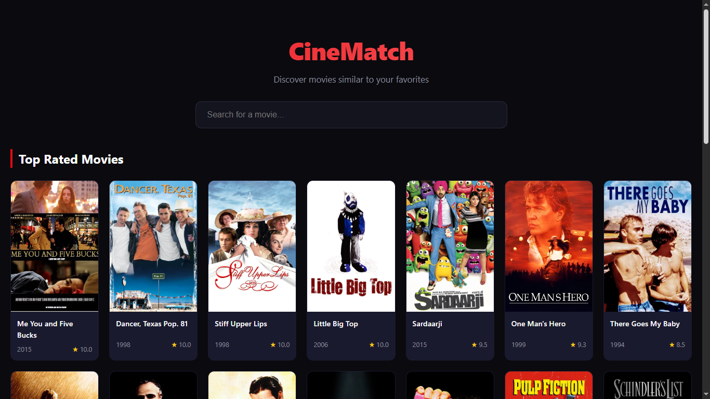
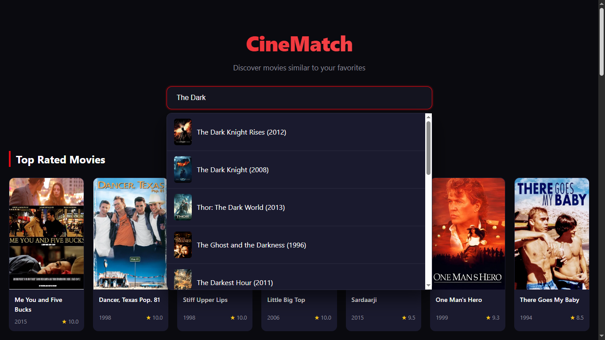
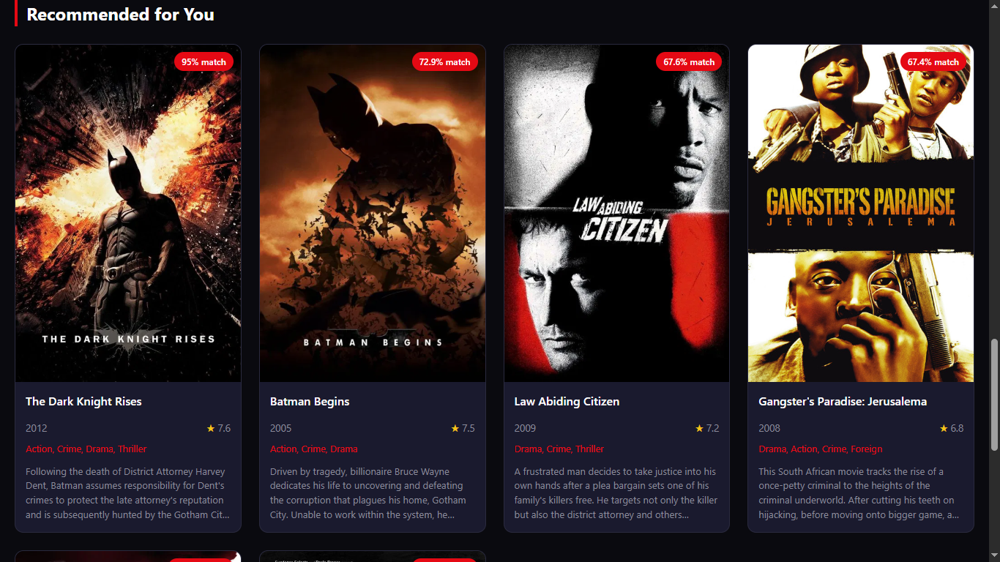

# 🎬 CineMatch — Content-Based Movie Recommender

A full-stack movie recommendation web application that uses **Natural Language Processing (NLP)** and **content-based filtering** to discover movies similar to a user's favorite titles.

Built with **Python, Flask, scikit-learn, pandas, and Vanilla JavaScript**, CineMatch analyzes movie metadata—including genres, directors, cast, and plot descriptions—to generate personalized similarity-based recommendations.

<p align="center">
  
  
  
  
</p>

---

## ✨ Overview

CineMatch is a **content-based recommendation system** designed to recommend movies based on their intrinsic characteristics rather than user ratings or collaborative behavior.

For each movie, the system combines:

* 🎭 Genres
* 🎬 Director
* 👥 Top cast members
* 📝 Plot overview
* 📅 Release information
* ⭐ Movie rating

These features are transformed into a numerical representation using **TF-IDF vectorization**, and movie-to-movie relationships are calculated using **cosine similarity**.

The project demonstrates the integration of **machine learning, backend API development, data processing, and responsive frontend engineering** into a single full-stack application.

---

## 📸 Screenshots

### 🏠 Home Page


### 🔍 Search


### 🎯 Recommendations


## 🎯 Key Features

### 🔍 Intelligent Movie Search

Search through a catalog of **4,800+ movies** with a responsive search interface.

### 🎯 Content-Based Recommendations

Get movies with similar metadata using a TF-IDF + cosine similarity recommendation pipeline.

### 📊 Similarity Scores

Each recommendation includes a similarity score representing its relationship to the selected movie.

### 🎨 Responsive Cinematic UI

Dark-themed interface designed for desktop, tablet, and mobile screens.

### ⚡ RESTful API

Flask-powered JSON API for requesting movie recommendations programmatically.

### 🖼 TMDB Poster Integration

Optional integration with the TMDB API for retrieving movie poster artwork.

---

## 🧠 Recommendation Pipeline

The recommendation engine follows a multi-stage pipeline:

```text
Raw TMDB Dataset
       │
       ▼
Data Cleaning & Merging
       │
       ▼
Feature Engineering
       │
       ▼
Combined Movie Representation
       │
       ▼
TF-IDF Vectorization
       │
       ▼
Cosine Similarity
       │
       ▼
Top-N Recommendations
```

### 1. Data Preparation

The original TMDB datasets:

* `tmdb_5000_movies.csv`
* `tmdb_5000_credits.csv`

are merged and transformed into a cleaned movie dataset.

Relevant features include:

* Genres
* Director
* Top 5 cast members
* Plot overview
* Release year
* Rating

The processed dataset contains **4,800+ movies**.

---

### 2. Feature Engineering

Movie metadata is combined into a single text representation used by the recommendation engine.

Different feature groups are given different weights to influence their contribution to similarity:

```python
soup = (genres × 5) + (director × 3) + (cast × 2) + overview
```

This allows the recommendation model to emphasize structured movie attributes such as genre and director while still incorporating plot information.

---

### 3. TF-IDF Vectorization

The combined movie representation is converted into a numerical matrix using **TF-IDF (Term Frequency–Inverse Document Frequency)**.

TF-IDF increases the importance of distinctive terms while reducing the influence of terms that appear frequently across many movies.

This creates a vector representation for each movie that can be compared mathematically.

---

### 4. Cosine Similarity

The system calculates the cosine similarity between movie vectors.

Conceptually:

```text
Movie A ─────────────┐
                     │
                     ▼
              Cosine Similarity
                     │
                     ▼
Movie B ─────────────┘
```

Movies with more similar feature representations receive higher similarity values.

For a selected movie, the recommendation engine retrieves the highest-scoring movies while excluding the selected movie itself.

---

### 5. Recommendation Ranking

Recommendations are sorted by their similarity to the selected movie and the top results are returned through the Flask API.

> **Note:** The displayed similarity percentage is a presentation-layer score derived from the underlying cosine similarity. It should not be interpreted as a probability that a user will enjoy the movie.

---

## 🛠 Tech Stack

| Layer                  | Technology                      |
| ---------------------- | ------------------------------- |
| **Language**           | Python 3.10+                    |
| **Backend**            | Flask                           |
| **Machine Learning**   | scikit-learn                    |
| **NLP**                | TF-IDF                          |
| **Similarity Model**   | Cosine Similarity               |
| **Data Processing**    | pandas, NumPy                   |
| **Frontend**           | HTML5, CSS3, Vanilla JavaScript |
| **Movie Data**         | TMDB 5000 Movie Dataset         |
| **External API**       | TMDB API                        |
| **Package Management** | pip / requirements.txt          |

---

## 📁 Project Structure

```text
movie-recommender/
│
├── app.py                  # Flask application and API routes
├── recommender.py          # Recommendation engine
├── data_loader.py          # Data loading and feature engineering
├── prepare_data.py         # Dataset preparation pipeline
├── add_posters.py          # TMDB poster integration
│
├── data/
│   └── movies.csv          # Processed movie dataset
│
├── templates/
│   └── index.html          # Main application page
│
├── static/
│   ├── style.css           # Application styling
│   └── script.js           # Frontend logic
│
├── requirements.txt        # Python dependencies
├── .gitignore
└── README.md
```

---

## 🚀 Getting Started

### Prerequisites

Make sure you have:

* Python **3.10+**
* pip
* Git

### 1. Clone the Repository

```bash
git clone https://github.com/Parsa-ux360/movie-recommender.git
cd movie-recommender
```

### 2. Create a Virtual Environment

#### Windows

```bash
python -m venv venv
venv\Scripts\activate
```

#### macOS / Linux

```bash
python3 -m venv venv
source venv/bin/activate
```

### 3. Install Dependencies

```bash
pip install -r requirements.txt
```

### 4. Run the Application

```bash
python app.py
```

### 5. Open the Application

Visit:

```text
http://localhost:5000
```

The processed `data/movies.csv` file is included in the repository, so the application can be started without rebuilding the dataset.

---

## 📦 Dataset Preparation

The included processed dataset can be used directly.

To rebuild it from the original TMDB files:

### 1. Download the Dataset

Download the **TMDB 5000 Movie Dataset** from Kaggle.

### 2. Add the Source Files

Place the following files inside `data/`:

```text
data/
├── tmdb_5000_movies.csv
└── tmdb_5000_credits.csv
```

### 3. Run the Preparation Pipeline

```bash
python prepare_data.py
```

This generates:

```text
data/movies.csv
```

containing the processed movie metadata used by the recommendation engine.

---

## 🖼 TMDB Poster Integration

CineMatch optionally supports movie posters through the TMDB API.

### Setup

1. Create a TMDB API account and obtain an API key.
2. Open:

```text
add_posters.py
```

3. Configure your API key:

```python
TMDB_API_KEY = "YOUR_API_KEY_HERE"
```

4. Run:

```bash
python add_posters.py
```

The script retrieves poster information for the movies in the dataset.

> ⚠️ Never commit API keys or other secrets to Git. Use environment variables for production deployments.

---

## 🔌 API

### Get Movie Recommendations

**Endpoint**

```http
POST /recommend
```

**Request**

```json
{
  "title": "Inception"
}
```

### Example with cURL

```bash
curl -X POST http://localhost:5000/recommend \
  -H "Content-Type: application/json" \
  -d '{"title": "Inception"}'
```

### Example Response

```json
{
  "recommendations": [
    {
      "title": "Interstellar",
      "year": 2014,
      "rating": 8.4,
      "genres": "Adventure, Drama, Science Fiction",
      "similarity": 82.5
    }
  ]
}
```

---

## ⚙️ Engineering Highlights

### Machine Learning

* Implemented a content-based recommendation algorithm from movie metadata.
* Applied TF-IDF vectorization to unstructured and semi-structured text.
* Used cosine similarity to measure relationships between movie representations.
* Implemented feature weighting to control the influence of different metadata fields.

### Backend

* Built a Flask-based web application.
* Designed JSON-based REST API endpoints.
* Separated recommendation logic from application routing.
* Added a preprocessing pipeline for reproducible dataset generation.

### Data Processing

* Merged multiple TMDB datasets.
* Parsed structured metadata such as genres, cast, and crew.
* Generated a unified feature representation for each movie.
* Processed a catalog of 4,800+ movies using pandas and NumPy.

### Frontend

* Built a responsive interface using HTML, CSS, and Vanilla JavaScript.
* Implemented client-side API communication.
* Designed a cinematic dark-themed user interface without relying on frontend frameworks.

---

## 📈 Potential Improvements

The current architecture provides a foundation for several future extensions:

* **Hybrid recommendation:** combine content-based filtering with collaborative filtering.
* **User profiles:** store favorites and recommendation history.
* **Authentication:** add secure user authentication and authorization.
* **Recommendation evaluation:** introduce metrics such as Precision@K and Recall@K where suitable.
* **Automated testing:** add unit and integration tests with pytest.
* **Containerization:** provide a Docker-based development and deployment environment.
* **Production deployment:** deploy the application using a cloud platform.
* **Recommendation caching:** reduce repeated computation for frequently requested movies.
* **Database integration:** replace static CSV storage with a production database.

---

## 📚 Data Source

Movie metadata is based on the **TMDB 5000 Movie Dataset**, distributed through Kaggle.

Source:

https://www.kaggle.com/datasets/tmdb/tmdb-movie-metadata

Movie poster data is optionally retrieved through the TMDB API.

---

## 📄 License

This project is licensed under the **MIT License**.

---

## 👤 Author

**Parsa Shahi**

GitHub: [@Parsa-ux360](https://github.com/Parsa-ux360)

Email: `parsashahi89@gmail.com`

---

## ⭐ Why This Project?

CineMatch was built as a practical demonstration of combining:

**Machine Learning + NLP + Data Processing + REST APIs + Full-Stack Web Development**

into a single end-to-end application.

The goal was not only to train a recommendation model, but to integrate that model into a usable web product with a clear data pipeline, backend API, and responsive frontend.